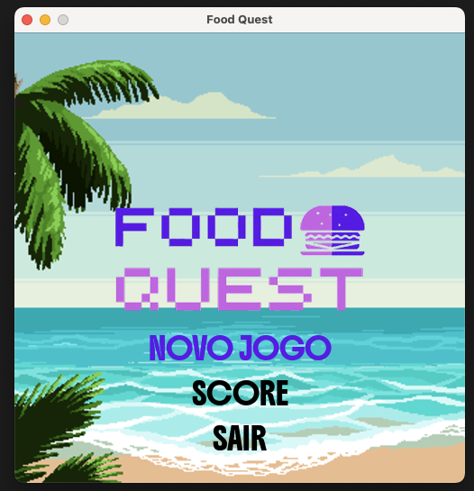
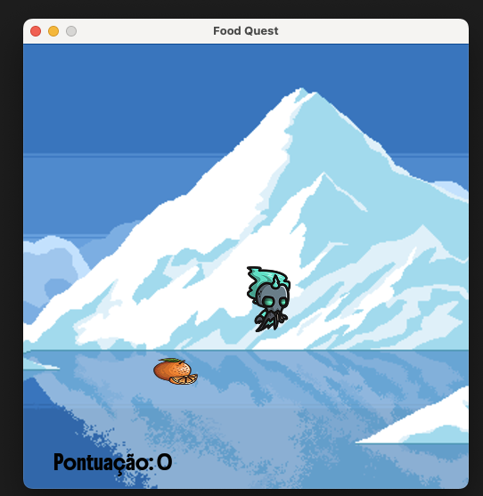
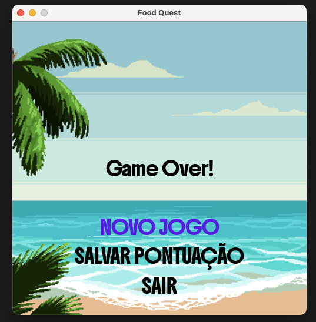
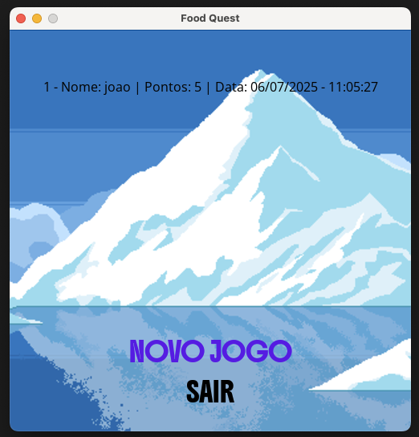

# Food Quest

## Overview

A 2D game developed with Pygame for a college assignment.

## Game

The goal of the game is to collect food while avoiding non-food items. This game was inspired by ConSumo from Bully.

### Menu screen



### Gameplay

Player uses arrow keys to move the character and collect food. If the player is hit by a non-food item, the game is over.



#### Food


#### Non-food


### Game over screen

In the game over screen the player can choose to start a new game or save score.



### Score screen



## ▶️ How to Run

1. **Clone this repo**

```
git clone https://github.com/jf-gomes/food_quest.git
cd food_quest
```

2. **Create and activate a virtual environment (optional, but recommended)**

```
# macOS/Linux
python3 -m venv venv
source venv/bin/activate

# Windows
python -m venv venv
venv\Scripts\activate
```

3. **Install dependencies**

```
pip install -r requirements.txt
```

4. **Run application**

```
python3 main.py
```

## Used Technologies

- [PyGame](https://www.pygame.org/news)

## Author

João Gomes
[LinkedIn](https://www.linkedin.com/in/joao-v-f-gomes/)